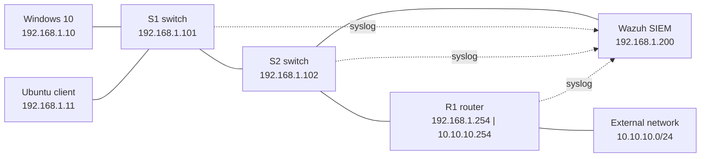

# Secure Network & SIEM Lab: Cisco + Wazuh

> A hardened Cisco network with centralised security monitoring, built from scratch in a virtual lab. Cisco devices forward syslog to a Wazuh SIEM, where custom detection rules identify failed logins, configuration changes and brute-force attacks.


---

## At a glance

| | |
|---|---|
| **Goal** | Build, secure and monitor a small enterprise network |
| **Devices** | 1 router, 2 switches, 3 hosts, 1 SIEM server |
| **Platform** | Cisco Modeling Labs inside VMware, bridged to real VMs |
| **Outcome** | Full connectivity, hardened devices, and brute-force attacks detected and escalated in Wazuh |

---

## Skills demonstrated

| Area | Skills |
|---|---|
| **Networking** | IPv4 addressing, VLANs, inter-network routing, switch port management, CDP |
| **Network security** | SSH v2 only, Telnet disabled, hashed passwords, brute-force lockout, unused port isolation |
| **SIEM / SOC** | Syslog forwarding, log decoding, custom detection rules, event correlation, alert tuning |
| **Virtualisation** | VMware virtual networks, Linux bridges, connecting hypervisor VMs into Cisco CML |
| **Linux administration** | Netplan, NetworkManager (`nmcli`), static routing, `tcpdump`, `systemctl` |
| **Troubleshooting** | Layer-by-layer fault isolation from physical link to application |
| **Documentation** | IP plans, port maps, evidence capture, configuration backups |

---

## Topology



**Hybrid lab design:** the Windows and Wazuh machines are full VMware VMs, connected into the Cisco Modeling Labs topology through dedicated host-only networks, Linux bridges and CML External Connectors. This mirrors connecting physical servers to a network.

---

## Device hardening

Applied consistently to **R1, S1 and S2**:

- **SSH v2 only**, with 2048-bit RSA keys; Telnet refused
- **Hashed secrets** for privileged mode and local admin accounts
- **Brute-force protection**: 3 failed logins in 60s locks out access for 2 minutes
- **Login auditing**: successful and failed logins logged
- **Idle session timeouts** on console and remote lines
- **Web management disabled** (HTTP/HTTPS servers off)
- **Unused ports shut down** and moved to an isolated VLAN 999
- **CDP disabled** on the external-facing router interface
- **IP source routing disabled** on the router

**Verified with:** SSH login tests, port 23/22 reachability tests, and `show login` during a simulated attack.

---

## Centralised logging and detection

### Log pipeline

```
Cisco device ──syslog UDP 514──▶ Wazuh listener ──▶ cisco-ios decoder ──▶ rules ──▶ dashboard alert
```

- Wazuh listener restricted to the lab subnet and the lab interface only
- Each stage verified independently: `tcpdump` → archive logs → `wazuh-logtest` → dashboard

### Custom detection rules

| Rule | Detects | Level |
|---|---|---|
| `100100` | Failed SSH authentication on a network device | 7 |
| `100101` | Successful SSH login (audit trail) | 3 |
| `100102` | Device configuration changed | 5 |
| `100103` | **Brute force**: 3 failed logins within 60 seconds (correlation rule) | 10 |
| `100104` | **Device lockout triggered**: Cisco's own protection activated | 10 |

**Defence in depth:** brute-force attacks are detected independently by the device (`100104`) and by SIEM correlation (`100103`), so detection still works if a device's own protection is missing or misconfigured.

---

## Troubleshooting highlights

Real problems found and fixed during the build:

| Problem | Diagnosis | Fix |
|---|---|---|
| Router couldn't reach the switches | Interface up on one side, `down/down` on the other, no CDP neighbour | Found a disabled link endpoint in CML link statistics |
| Logs reached the server but raised no alerts | `wazuh-logtest` showed the default Cisco rule at **level 0** (silent) | Wrote custom child rules to raise relevant events |
| Brute-force rule never fired | SSH auth failures are logged **once per session**, not per attempt | Rebuilt the rule to count per-attempt `LOGIN_FAILED` events |
| SSH rejected the correct password | `show running-config` revealed `login` instead of `login local` on remote lines | Restored local authentication and re-verified |
| Device configs lost after a power cut | The backup held topology only, without device configs | Rebuilt the devices; now extract configs before every backup and verify them |
| SIEM couldn't reach the external network | Dual-homed server's default route went via the management NIC | Added a targeted static route via the router |

---

## Key lessons

- **Verify, don't assume.** `show` commands after every change caught silently lost configuration.
- **A backup isn't a backup until it's been tested.**
- **SIEM tuning matters.** Out-of-the-box rules missed security-relevant events; understanding the logs made the detections reliable.
- **Test detection logic with the real log format.** The first brute-force rule looked right but didn't match how the device actually logs.

---

## Future improvements

- [ ] Add an attacker VM (Kali) on the external network for realistic attack simulation
- [ ] NTP time synchronisation, for accurate log timestamps and correlation
- [ ] Custom decoder to extract the attacker's source IP, allowing per-source correlation (`same_srcip`)
- [ ] Wazuh agents on the Windows and Ubuntu hosts for endpoint monitoring
- [ ] Management ACLs restricting SSH to an admin subnet

---

## Tools

`Cisco Modeling Labs` · `Cisco IOS / IOSvL2` · `Wazuh` · `VMware Workstation` · `Ubuntu` · `Windows 10` · `tcpdump` · `PowerShell` · `netplan` · `nmcli`
